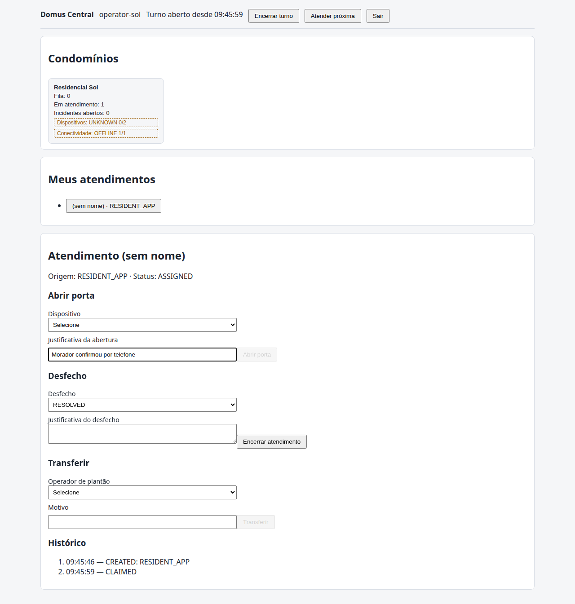
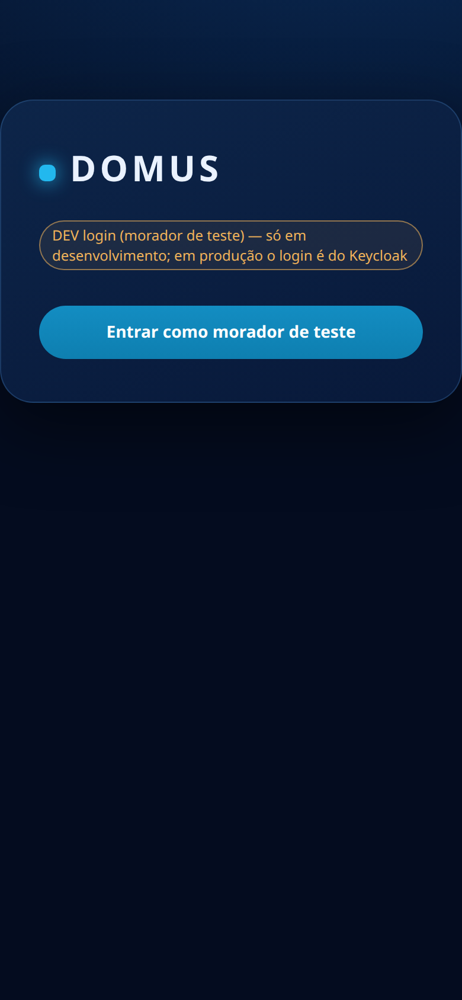
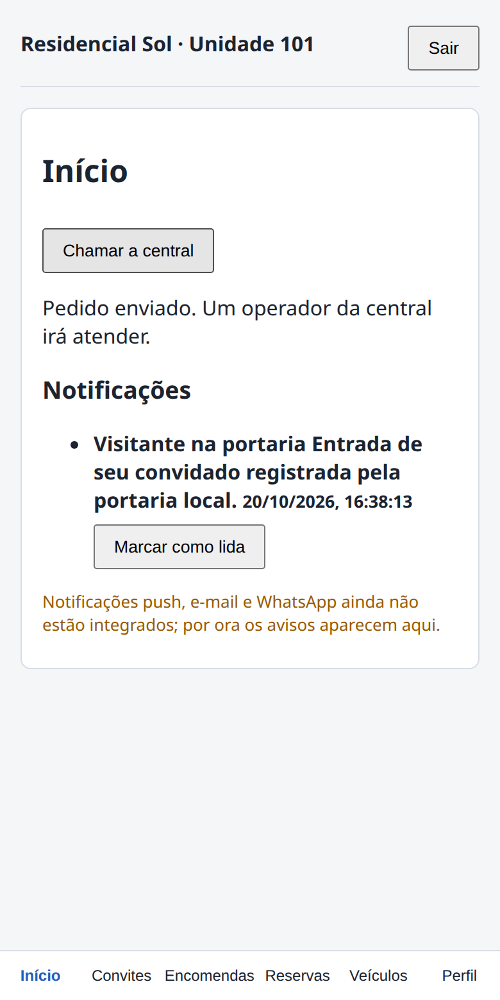
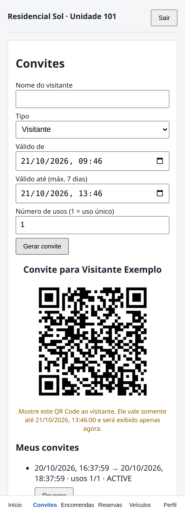
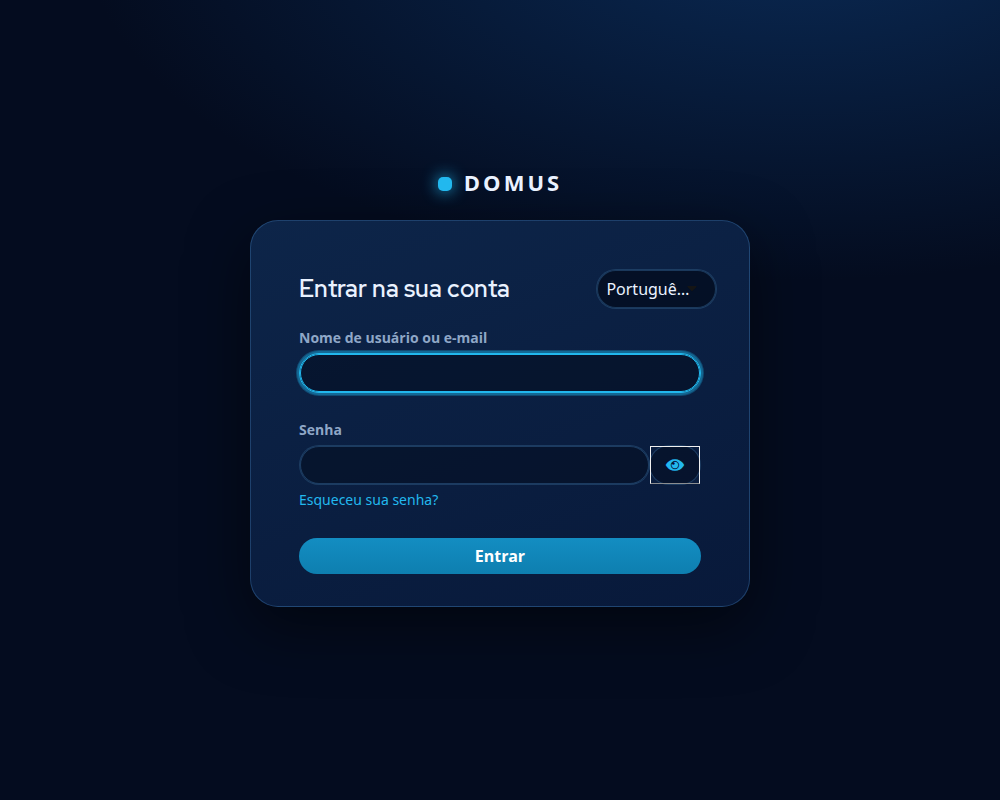

# Domus — plataforma de portaria virtual multicondomínio

Monólito modular Java (Spring Boot 4.0.7, Java 26) para empresas que operam portaria remota de vários condomínios.
Fases 0–8 executadas, **não pronto para produção** (nada testado com hardware real). Veja [docs/STATUS.md](docs/STATUS.md) para o que está
concluído, simulado e pendente.

## Telas

Capturas do ambiente de desenvolvimento (perfil `dev`, dados fictícios, equipamentos simulados). O tema escuro (azul-marinho com destaque ciano) é compartilhado pelos dois apps em `web/shared/src/theme.css`.

**Painel da central** (operador): atendimento em andamento, abertura de porta com justificativa obrigatória, desfecho, transferência e histórico.



**App do morador** (PWA, no celular): início com chamada à central e convite com QR Code de uso limitado.

<p>
  
  
  
</p>

**Login (Keycloak)**: tema `domus` em `deploy/keycloak/themes/domus`, na mesma paleta, em português.



## Rodar localmente

Requisitos: JDK 26, Maven 3.9.9, Docker, Node 22.12+.

```bash
docker compose up -d postgres                                    # PostgreSQL 17 na porta 5433
cd backend
DB_PASSWORD=portaria_dev_only SPRING_PROFILES_ACTIVE=dev mvn spring-boot:run   # API 8081, gestão 8082
```

O perfil `dev` semeia dados **fictícios** (2 empresas, 3 condomínios, dispositivos simulados) e expõe `/dev/token` para tokens de teste
(inexistente em produção). Usuários: `platform-admin`, `alpha-admin`, `beta-admin`, `operator-sol`, `operator-multi`, `manager-sol`,
`resident-sol`. Swagger: <http://localhost:8081/swagger-ui.html>.

```bash
cd web && npm install
npm run dev -w panel        # painel da central  -> http://localhost:5173
npm run dev -w resident     # app do morador     -> http://localhost:5174
```

Opcionais: Prometheus/Grafana `docker compose -f docker-compose.yml -f docker-compose.observability.yml up -d`
(<http://localhost:9090>, <http://localhost:3000>, admin/`admin_dev_only`); Keycloak
`docker compose -f docker-compose.keycloak-dev.yml up -d` (<http://localhost:8180>).

## Testes e provas

```bash
mvn -f backend/pom.xml verify          # 131 testes (Testcontainers: precisa do Docker)
mvn -f agent/pom.xml test              # 36 testes (sem Docker)
cd web && npm test                     # 50 testes de UI/OIDC/renovação de token

mvn -f backend/pom.xml package -DskipTests && mvn -f agent/pom.xml package
./scripts/e2e-contingency.sh           # queda real da central + agente local
python3 scripts/verify_keycloak.py     # login de navegador, MFA, PKCE e API (precisa do Keycloak dev)
./scripts/restore-drill.sh             # backup -> restauração -> verificações
python3 scripts/e2e-browser.py         # navegador real (Playwright): morador e operador
./scripts/e2e-agent-update.sh          # atualização assinada do agente com jars reais
./scripts/test-agent-launcher.sh       # rollback do launcher do agente
python3 scripts/load-test.py           # latência/vazão (API com perfil dev e limites de taxa elevados)
```

## Estrutura

```
backend/   API, pacote br.com.domus.platform: um pacote por domínio (identity, commercial, residents, vehicles, parcels, reservations,
           access, notifications, operations, devices, agent, privacy, dev) dividido em controller/service/repository/entity (ADR 0007);
           shared/ com auditoria, tenant, criptografia, erros e observabilidade
web/       painel da central e app do morador (React + TypeScript, cliente OIDC compartilhado)
agent/     agente local de contingência (Java, SQLite)
deploy/    produção: Caddy (TLS), Keycloak (realm com MFA), Prometheus/Grafana, compose de produção
scripts/   backup, restauração, drill, provas ponta a ponta, teste de carga
docs/      STATUS, operação, segurança, LGPD, agente, ADRs, análise dos repositórios de referência, inventário de licenças
```

Documentação: [Pendências](pendencias.md) · [STATUS](docs/STATUS.md) · [Operação](docs/operations.md) · [Segurança](docs/security.md) · [LGPD](docs/lgpd.md) ·
[Agente local](docs/agent.md) · [ADRs](docs/adr) · [Licenças das referências](docs/reference-analysis/LICENSES.md) · [Inventário](docs/inventory/README.md)

## Licença

[Apache 2.0](LICENSE). Avisos de componentes de terceiros em [THIRD_PARTY_NOTICES.md](THIRD_PARTY_NOTICES.md).
